# AC2 – API REST de Clientes e Pedidos

Prints dos testes realizados no Postman.

### 1. Listar todos os clientes
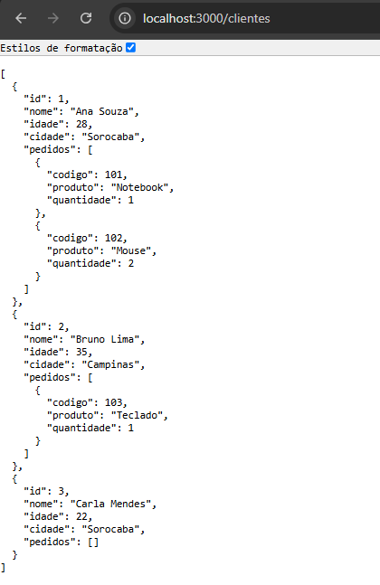
# AC2 – API REST de Clientes e Pedidos

Prints dos testes realizados no Postman.

### 1. Listar todos os clientes

### 2. Buscar cliente por ID
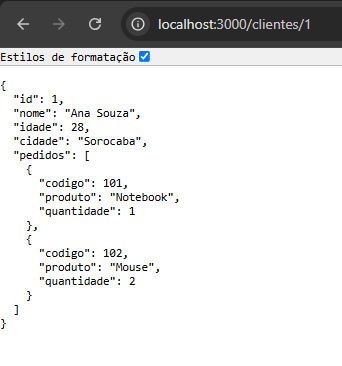

### 3. Listar os pedidos de um cliente
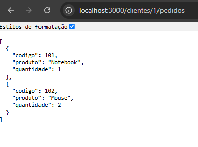

### 4. Consultar clientes por cidade
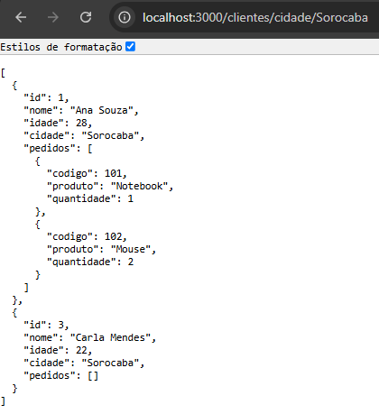

### 5. Adicionar pedido a um cliente
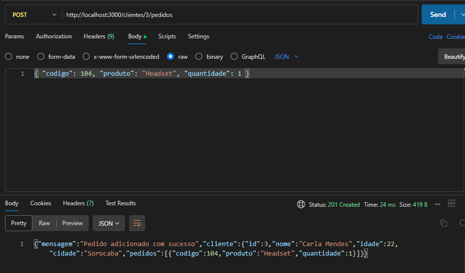

### 6. Pedido salvo na lista do cliente
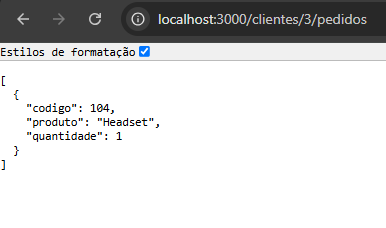

### 7. Atualizar cliente
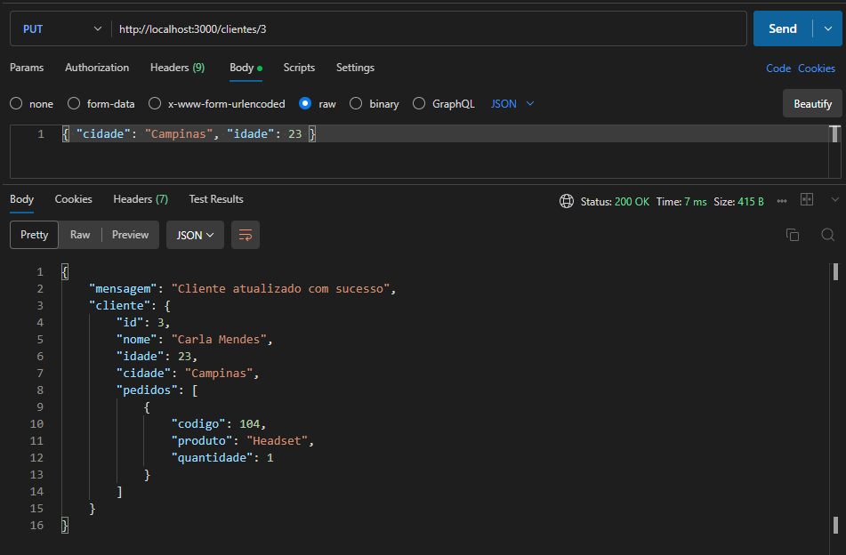

### 8. Atualizar cliente com ID inexistente
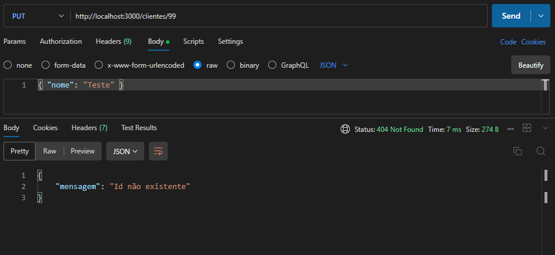

### 9. Remover cliente
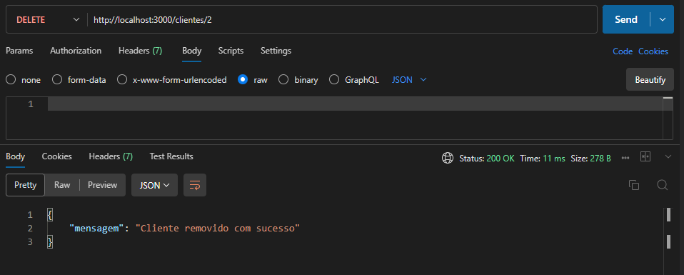

### 10. Remover cliente com ID inexistente
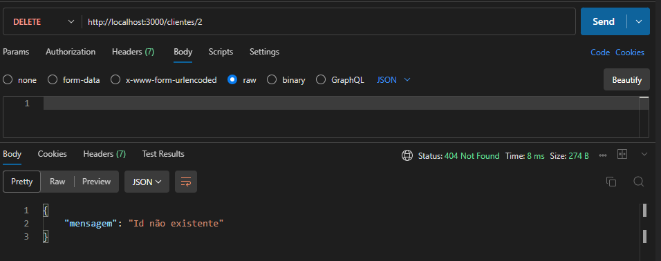

### 11. Lista final
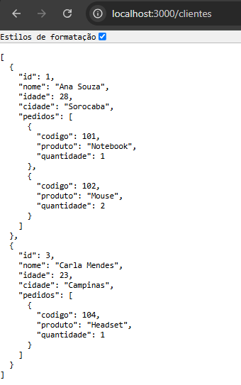
### 2. Buscar cliente por ID

### 3. Listar os pedidos de um cliente

### 4. Consultar clientes por cidade

### 5. Adicionar pedido a um cliente

### 6. Pedido salvo na lista do cliente

### 7. Atualizar cliente

### 8. Atualizar cliente com ID inexistente

### 9. Remover cliente

### 10. Remover cliente com ID inexistente

### 11. Lista final
